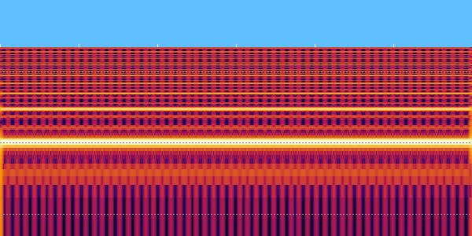
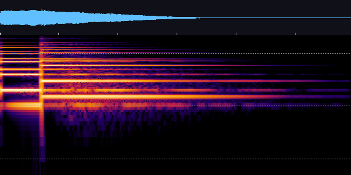

<div align="center">

# 🔊 game-sfx

**Game sound effects your AI agent can actually design.**

[](LICENSE)
[](#install)
[](#privacy--network)
[](#install)
[](#it-learns-your-game)

</div>

Ask Claude for a coin sound and you usually get a raw beep that clicks, hisses and lasts too long. Claude can't hear, so it can't tell.

## Before → after

Same request, "a coin pickup sound". The doctor report and spectrogram are what Claude sees:

| What an agent usually writes | With game-sfx (`coin_cartoon`) |
|---|---|
|  |  |
| `FAIL clipped` · `WARN clicks at start/end` · `WARN flat, no transient` · 0 dBFS, 0.6 s of buzz | `OK` · -16 LUFS · a two-note FM bell that rings out and decays to silence |
| 🎧 [naive_beep.wav](examples/naive_beep.wav) | 🎧 [coin_cartoon.wav](examples/coin_cartoon.wav) |

*Top strip: amplitude. Below: log-frequency spectrogram (50 Hz to 22 kHz). Dotted lines mark 100 Hz, 1 kHz and 10 kHz.*

## What's inside

**game-sfx** is a Claude Code skill that works around the fact that Claude can't hear:

- **Recipes.** Layered patches (transient + body + tail) built from sound-design practice and sfxr's own presets.
- **Synth.** A click-proof synth with band-limited oscillators, envelopes that always end at zero, DC removal, LUFS-matched loudness and tail trimming.
- **Sample pipeline.** For real-world foley, it finds CC0 recordings on Freesound, cuts out the cleanest single hits, and layers them as *shared impact + surface texture + small room*.
- **Doctor.** Measures peak, LUFS, crest, brightness and harsh/aliasing energy, then draws a **spectrogram PNG**. Claude reads that picture to check its own work. It reads WAV (including float), OGG and MP3.
- **Preview.** Lays sounds out the way the game plays them (gallop, walk, sequence), old vs new, so **your ears** make the final call.
- **Typo-proof patches.** An unknown key fails with "did you mean 'filters'?" instead of silently producing a wrong sound.

The synth is **pure Python stdlib**: no pip install, no API key, works offline. For realistic foley (hooves, footsteps, water) the **sample pipeline** finds CC0 recordings on Freesound, cuts out the cleanest hits and makes them game-ready (needs a free Freesound key + ffmpeg). Output is game-ready WAV for Godot, Unity, Unreal, Phaser and anything else.

## Install

In Claude Code:

```
/plugin marketplace add GhazaGG/Game-Sound-Effect-for-Claude
/plugin install game-sfx@game-sfx
```

Or copy `skills/game-sfx/` into `~/.claude/skills/`.

## Use

Just ask:

> make a coin pickup sound for my platformer, with 4 variants

> my hit sounds are weak, audit `assets/sfx/` and fix them

> I need a looping horse gallop for a courier game

Claude picks a recipe, renders it, reads the doctor report and spectrogram, iterates, and writes the files into your project. The JSON patch stays in your project too, so you can tweak it later.

You can also run the scripts yourself:

```bash
python skills/game-sfx/scripts/sfx.py skills/game-sfx/recipes/coin_cartoon.json -o out --variants 4 --png
python skills/game-sfx/scripts/doctor.py path/to/your/*.wav --png
```

```
coin_cartoon.wav  0.594s
  peak -6.4 dBFS | -16.0 LUFS | crest 12.1 dB | centroid 3452 Hz
  energy <80Hz 0% | 2-5kHz 41% | >16kHz 0.0% | lead 0 ms
  OK no problems found
```

## Included recipes

Listen to them in [`examples/`](examples/).

| Recipe | Style | What it is |
|---|---|---|
| `coin_cartoon` | cartoon | FM-bell "bling" with shimmer and a small room |
| `jump_cartoon` | cartoon | Springy "boing" with a decaying wobble |
| `hit_cartoon` | cartoon | Rounded "bonk": thump plus woodblock knock |
| `horse_gallop_cartoon` | cartoon | Coconut-shell clip-clop, seamless loop |
| `coin_retro` | retro | Two-note square pickup |
| `jump_retro` | retro | Detuned square sweeping up |
| `hoof_dirt_foley` | grounded | **Recorded** CC0 hoof impact + dirt texture, 4 paired variants (approved by ear in a Unity prototype) |
| `ui_click` | any | Tiny tick + blip |
| `hit` | synth placeholder | Noise snap + saturated thump + crunch. Replace with recordings for a grounded game |
| `horse_gallop` | synth placeholder | Procedural gallop loop. It sounds toy-like next to real hooves; use only as a stand-in |

Styles are first-class. Tell Claude your game's look and every sound comes from the same palette (see [SKILL.md](skills/game-sfx/SKILL.md#style)).

[SKILL.md](skills/game-sfx/SKILL.md) has a recipe table for 12 more categories: laser, explosion, power-up, hurt, death, jingle, footstep, whoosh, magic and the UI hover, confirm and error sounds.

## It learns your game

Claude doesn't make sounds blind. On first use it does three things:

1. **Detects your engine** (Godot, Unity, Unreal, Phaser, GameMaker, LÖVE, Pygame) and its audio folder.
2. **Reads your project.** It looks at the README, design docs and art, audits the sounds you already have, and greps your code for gameplay events (`jump`, `collect`, `hit`...) that have no sound yet.
3. **Writes `sfx/SOUND_STYLE.md`**, a short sound bible covering style, palette, world materials, music key and loudness tiers. Every future sound follows it, so they all sound like one game.

Every sound keeps its editable source in `sfx/patches/<name>.json`. To change one, say "the coin is too shrill" and Claude edits the patch, re-renders it to the same file and logs the decision. Or edit the JSON yourself.

## How it works

```
request → synth or samples?
   synth:   recipe → sfx.py
   samples: freesound.py → slice.py → sfx.py (impact + texture layers)
→ doctor.py (metrics + spectrogram) → Claude looks → tweak → variants
→ preview.py (A/B in the game's rhythm) → you listen → your assets/
```

## Privacy & network

- **Offline by default.** `sfx.py`, `doctor.py`, `slice.py` and `preview.py` never touch the network. They read and write only the files you point them at.
- **`freesound.py` is the only script that goes online.** It calls `https://freesound.org/apiv2` (search, sound info) and downloads the preview files it links to. It sends nothing else: no telemetry, no project files.
- **Your Freesound key** is read from the `FREESOUND_API_KEY` environment variable. On Windows, if it isn't in the environment, it is read from the user's registry environment. The key is sent only to freesound.org in the `Authorization` header and is never printed or written to disk.
- **External programs:** `ffmpeg` / `ffprobe` (if installed) decode non-WAV audio. They are called with argument lists, never through a shell.

## Roadmap

- [x] Click-proof synth, doctor and spectrograms
- [x] CC0 sample pipeline (Freesound search, hit slicer, hybrid foley layers)
- [x] Game-rhythm A/B previews
- [ ] More recipes approved by ear (explosion, laser, magic, footsteps per surface)
- [ ] OGG export and engine import snippets
- [ ] Optional AI backends for realistic sounds (ElevenLabs, Stable Audio Open)
- [ ] Web demo page: prompt → sound, side by side with a naive beep

## Contributing

Recipes improve when people listen to them.

- **Tried a recipe in your game?** Open an [issue](https://github.com/GhazaGG/Game-Sound-Effect-for-Claude/issues) saying what sounded off ("coin too shrill", "hit has no weight"), plus your engine and style.
- **Made a sound you're proud of?** Share the patch JSON in [Discussions](https://github.com/GhazaGG/Game-Sound-Effect-for-Claude/discussions). The best ones become recipes.
- **Code changes:** run `python tests/test_recipes.py` before a PR.

If game-sfx saved your game from raw beeps, a ⭐ helps other devs find it.

MIT licensed. Sounds you make with it are yours.
